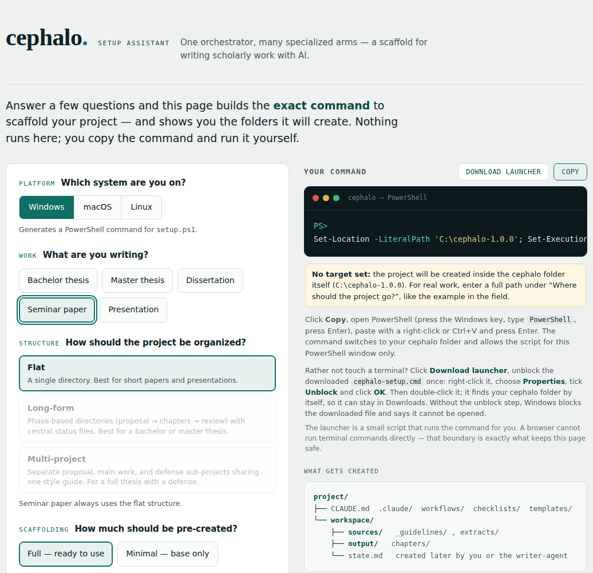
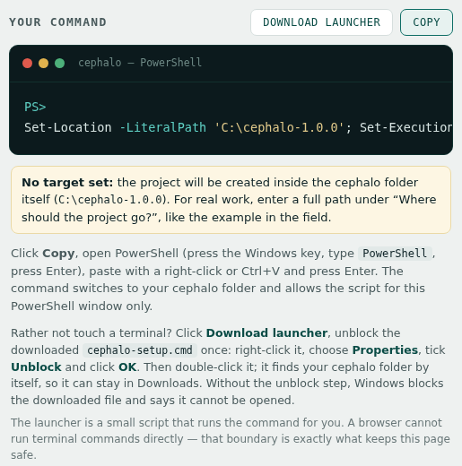
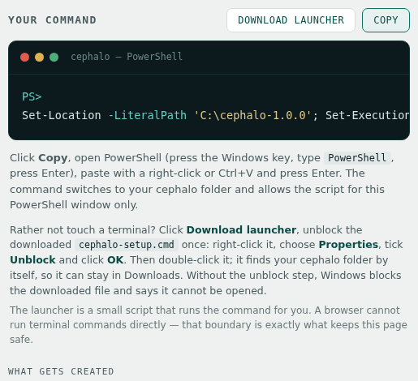
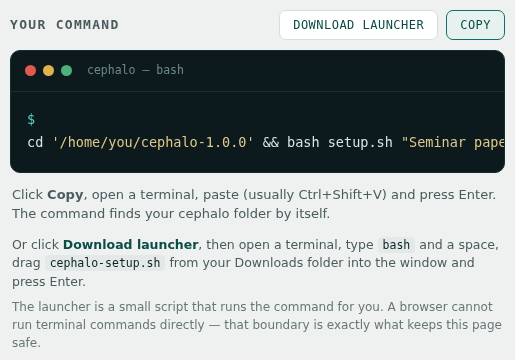

# Setup guide with screenshots

This guide walks through the setup assistant, `docs/setup-wizard.html`, step by step. Apart from pasting one line into a terminal, it needs no command-line knowledge. The screenshots use example folders (`C:\cephalo-1.0.0` on Windows, `/home/you/cephalo-1.0.0` on Linux); your page shows the folder you extracted cephalo to.

If you prefer the command line, `README.md` (Quick start) and `QUICKSTART.md` describe the same setup without the assistant.

---

## 1. Download and extract

- Download cephalo as a ZIP: a release archive from the project's Releases page, or **Code -> Download ZIP** on its GitHub page.
- Extract it. Windows: right-click the ZIP, **Extract All**. macOS: Safari usually extracts it by itself; otherwise double-click the ZIP. Linux: `unzip`.
- Leave the extracted folder where it is, for example in Downloads. The setup copies it to your project folder in step 5.

## 2. Open the setup assistant

In the extracted folder, open `docs` and double-click `setup-wizard.html`. It opens in your browser, works offline and runs nothing itself: it only builds the command you run in step 5.

Your system is preselected under **Which system are you on?**; switch it if the page guessed wrong.



## 3. Answer the questions

- **What are you writing?** Seminar papers and presentations always use the flat structure.
- **How should the project be organized?** Flat, Long-form or Multi-project; `README.md` (Project structure variants) explains the differences.
- **How much should be pre-created?** *Full* creates all folders at once; *Minimal* leaves most of them to the style-resolver.

The preview on the right (**What gets created**) shows the folders the setup will create.

## 4. Choose where the project goes

Enter a full path under **Where should the project go?**, for example `C:\Thesis\Seminar` on Windows or `~/Documents/Thesis` on macOS and Linux. The setup copies cephalo there and creates your project inside.

If you leave the field empty, the project is created inside the extracted cephalo folder itself, and the page says so in a yellow note:



## 5. Copy the command and run it

Click **Copy**. The command starts by changing into your cephalo folder, so it works in any terminal window.

**Windows:** open PowerShell (press the Windows key, type `PowerShell`, press Enter), paste with a right-click or Ctrl+V, and press Enter. The command also allows the setup script for this PowerShell window only, so no separate `Set-ExecutionPolicy` step is needed.



**macOS:** open Terminal (press Cmd+Space, type `Terminal`, press Enter), paste with Cmd+V and press Enter. If macOS asks whether Terminal may access your Downloads folder, allow it.

**Linux:** open a terminal, paste (usually Ctrl+Shift+V) and press Enter.



The setup prints each folder it creates and ends like this:

```text
============================================================
Setup complete
============================================================

Work type:    Seminar paper
Structure:    Flat
Scaffolding:  full
```

With a target, on macOS and Linux it then asks **Delete it now? [y/N]** about the extracted cephalo folder: your project has its own copy, so `y` is safe once the setup has completed; `n` keeps the folder. The Windows command does not ask; it keeps the folder and prints the command to delete it.

## 6. Windows only: the launcher instead of PowerShell

Rather not open PowerShell? Click **Download launcher**. Your browser saves `cephalo-setup.cmd`, usually in Downloads, where it can stay: it finds your cephalo folder by itself.

Windows blocks this downloaded file until you unblock it once: right-click `cephalo-setup.cmd`, choose **Properties**, tick **Unblock** at the bottom of the **General** tab and click **OK**. Then double-click it. Without that step, Windows only says that the file cannot be opened; `README.md` (FAQ) explains why a launcher cannot unblock itself.

macOS gets no launcher: it blocks a double-click on any script downloaded with a browser, so the command from step 5 is the way there.

## 7. Next steps

Continue with `README.md`, Quick start step 3 (put your institution's guidelines into the project) and step 4 (open the project in Claude Code and invoke the style-resolver). If something goes wrong during setup, see the Troubleshooting section in `QUICKSTART.md`.
